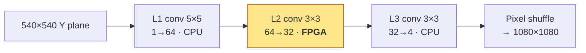

# INT8 Super-Resolution CNN Accelerator on the AMD VCK5000

An HLS hardware accelerator for **ESPCN ×2 image super-resolution**, built on the AMD/Xilinx VCK5000 (Versal VC1902) with Vitis HLS 2022.2 and XRT. The FPGA kernel computes the network's dominant 3×3 convolution (64→32 channels, **87 % of all MACs**) in INT8. Its output matches a quantized software reference **bit for bit**, and every speedup is measured on the real board.

> **Status:** specification, bit-exact golden model (T1) and CPU profiling done; model training and kernel versions in progress. See the [roadmap](#roadmap). FPGA performance figures are **design targets** until each version is measured on the board.

---

## Why this problem

Sending images at half resolution cuts the pixel count by 4×. A small neural network on the device can then upscale them. That only pays off if the upscaling runs on cheap, low-power hardware. This project builds and characterizes the compute core such an accelerator would need.

## Pipeline



| Layer | MACs / frame (540²) | MAC share | Measured CPU time | CPU share |
|---|---:|---:|---:|---:|
| L1 5×5, 1→64 | 0.47 G | 7.6 % | 0.087 s | 10.1 % |
| **L2 3×3, 64→32** | **5.37 G** | **87.0 %** | **0.694 s** | **81.1 %** |
| L3 3×3, 32→4 | 0.34 G | 5.4 % | 0.075 s | 8.8 % |

CPU times are measured on an Apple M2 (single thread, `-O2`, best of two loop orders per layer, bit-exact with the golden model; [results/profile/cpu_m2.txt](results/profile/cpu_m2.txt)). Accelerating L2 alone caps the application speedup at about 5.3× (Amdahl), which motivates the stretch goal of moving L1 and L3 onto the same engine.

## Kernel design

- **Line-buffer streaming.** Two 540-pixel line buffers and a 3×3 register window, so each input pixel is read from DDR exactly once.
- **HWC layout on 512-bit AXI.** With 64 INT8 channels, one bus word holds one pixel's whole input vector, so no data is split across words.
- **Parallel MAC array.** A To×Ti INT8 MAC array (target 32×16 = 512 MACs/cycle) with a Ti-wide adder tree, pipelined at II = 1.
- **Dataflow pipeline.** `read → window → compute → pack → write` stages connected by `hls::stream`, so I/O overlaps with compute.
- **One rounding contract.** Requantization (`quant.h`: 64-bit multiply, round-half-up shift, ReLU folded into the clamp) is shared by the golden model and the kernel, so the two cannot drift apart.

Full detail: [docs/01-architecture.md](docs/01-architecture.md).

## Optimization versions

Each version has a cycle-level analytical prediction, made from the HLS schedule before the board build, and is then measured on hardware.

| Ver | Change | Bottleneck it removes | Target |
|---|---|---|---|
| V0 | Scalar baseline, no pragmas | none (reference) | correctness |
| V1 | On-chip weights, unrolled To×Ti MAC array, II = 1 | serial MACs | big compute speedup |
| V2 | Line buffers + 3×3 window, burst I/O | redundant DDR reads | ≈ 36 cycles / pixel |
| V3 | Dataflow streaming across stages | serialized load / compute / store | ≈ 52 ms / frame @ 200 MHz |
| V4* | Parameterized engine for L1 + L3, or fused L1→L2→L3 | Amdahl cap (7.7×) | stretch |

**Results** (measured on the VCK5000; filled in per version from routed reports):

| Ver | Time (s) | GOPS | LUT | REG | BRAM | URAM | DSP | Freq (MHz) | WNS (ns) |
|---|---:|---:|---:|---:|---:|---:|---:|---:|---:|
| V0 | – | – | – | – | – | – | – | – | – |

## Verification

Correctness is checked in levels. Each level must pass before a 30-minute bitstream build is allowed. The full plan is in [docs/02-test-plan.md](docs/02-test-plan.md).

| Level | Check |
|---|---|
| T0 | INT8 model is within 0.3 dB PSNR of FP32 and beats bicubic (Set5) |
| T1 | C++ golden model is bit-exact with the Python integer reference |
| T2 | Kernel C++ is bit-exact with the golden model on 12 targeted cases (impulses, borders, saturation, rounding, odd sizes) in about 1 s on a laptop |
| T3 | HLS schedule shows the intended II, depth and resources |
| T4 | Hardware emulation passes |
| T5 | On-board run passes on the full 540×540 frame |
| T6 | End-to-end upscaled image is identical to the CPU-only pipeline |

## Quickstart (laptop)

```bash
pip install -r requirements.txt
make t1                                    # C++ golden == Python integer reference, bit for bit
make profile                               # per-layer CPU timing on a 540×540 frame
python3 -m model.data                      # download Set5, Set14, DIV2K into data/
python3 -m model.train                     # train FP32 ESPCN (~25 min on an M2 GPU)
python3 -m model.eval_psnr --ckpt model/espcn_fp32.pt   # T0: bicubic vs FP32 vs INT8 PSNR
```

## Repository layout

```text
docs/       design specs: goals, architecture, test plan, metrics, decision log
model/      PyTorch: train, INT8 quantization, weight export, test-vector generation
golden/     C++ bit-exact reference + shared quant.h
kernel/     Vitis HLS kernel versions (pl_v0..v4.cpp), XRT host, Makefile
test/       local kernel testbench + HLS stub headers
results/    per-version reports: routed utilization/timing, HLS log, run log, metrics
```

## Roadmap

- [x] Design specification, interfaces and test plan ([docs/](docs/README.md))
- [ ] FP32 ESPCN training and INT8 post-training quantization (T0)
- [x] Bit-exact C++ golden model, cross-checked against an independent Python integer reference (T1)
- [x] CPU per-layer profiling (laptop); VCK5000 host CPU still to do
- [ ] Roofline analysis on the VCK5000
- [ ] Local kernel testbench with all T2 cases
- [ ] V0 baseline on the board
- [ ] V1 → V3 optimizations, each with a predicted vs. measured cycle count
- [ ] Application-level analysis (fps, Amdahl bound, PSNR)

## Tools

Vitis / Vitis HLS 2022.2 · XRT · platform `xilinx_vck5000_gen4x8_qdma_2_202220_1` · C++17 · Python / PyTorch

---

Built as the final project for ENGN 2911X (FPGA acceleration) at Brown University.
