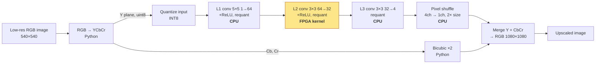
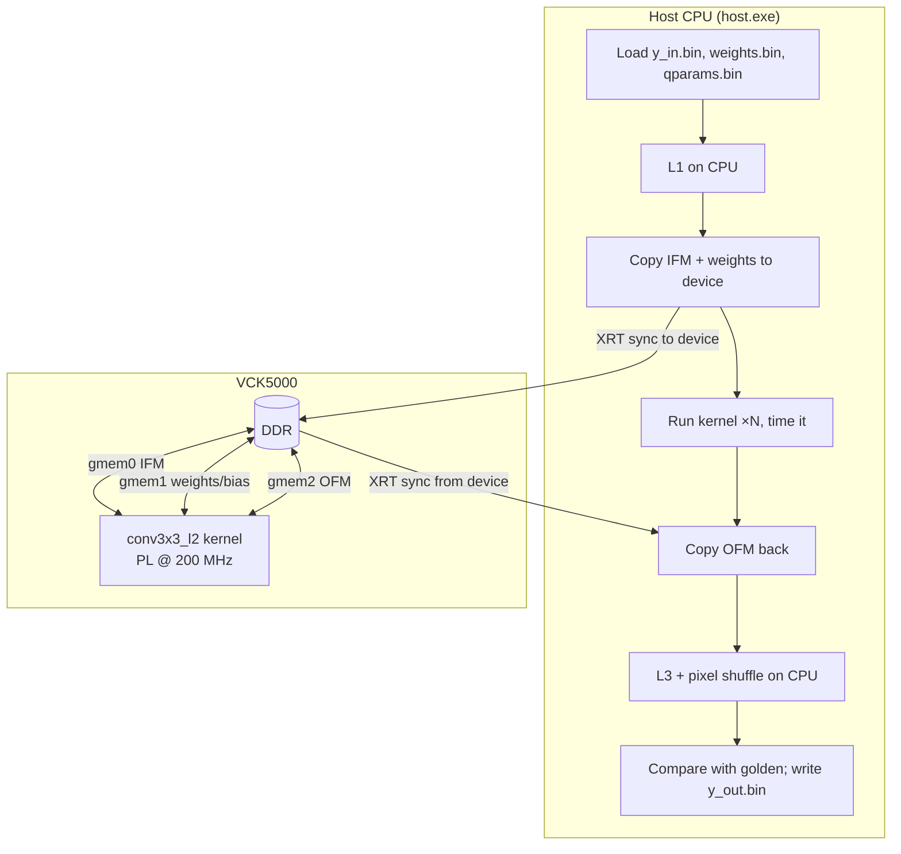
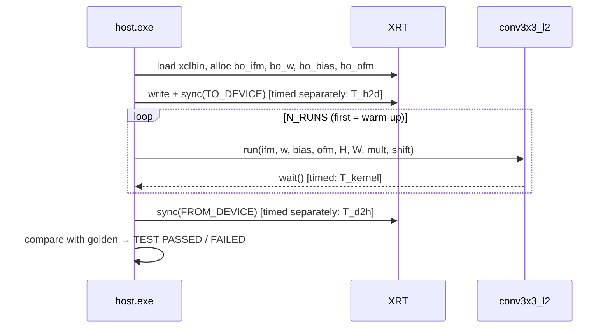
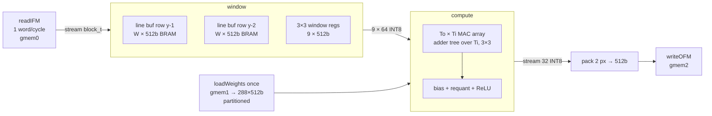

# 01 · Architecture

The doc goes from the outside in: the application, then the host and kernel split, then the inside of the kernel, then the data formats. **Interfaces and data layouts here are the contract.** The golden model, the tests and every kernel version must follow them. Change this doc first if any of them change.

---

## 1. Application pipeline



- Colour conversion, bicubic chroma and PSNR scoring happen **in Python, offline**. The C++ host only handles the Y plane as binary files. This keeps the timed path simple.
- Stretch S1/S2 moves L1 and L3 onto the FPGA as well ([00-goals.md](00-goals.md)).

## 2. System and host–kernel split





## 3. Kernel interface (contract)

```cpp
typedef ap_int<512> block_t;   // 64 × INT8

extern "C" void conv3x3_l2(
    const block_t *ifm,    // gmem0: H*W words. Word p = all 64 Cin of pixel p (HWC)
    const block_t *wts,    // gmem1: 32*9 = 288 words. Word (co*9 + ky*3 + kx) = 64 Cin
    const block_t *bias,   // gmem1: 2 words = 32 × int32
    block_t       *ofm,    // gmem2: H*W/2 words. Word q = pixels 2q, 2q+1 × 32 Cout
    int H, int W,          // frame size. Full run: 540 × 540. W must be even
    int requant_mult,      // fixed-point requantization multiplier (int32)
    int requant_shift);    // right shift
```

Each pointer gets `m_axi` on its bundle, plus `s_axilite` for scalars and return, the same as in Lab 3.

### Data layouts

| Tensor | Shape | Layout | Bytes (540²) | 512-bit words |
|---|---|---|---:|---:|
| IFM (L1 output) | 540×540×64 | HWC, INT8 | 18.7 M | 291,600 |
| Weights | 32×3×3×64 | [Cout][ky][kx][Cin] | 18,432 | 288 |
| Bias | 32 | int32 | 128 | 2 |
| OFM (L2 output) | 540×540×32 | HWC, INT8, 2 px/word | 9.3 M | 145,800 |

Bit positions inside a 512-bit word (all little-endian, so each `.bin` file can be `memcpy`'d straight into its buffer):

| Buffer | Element | Bits |
|---|---|---|
| IFM word p | channel c of pixel p | `8c+7 : 8c` |
| weight word co·9 + ky·3 + kx | Cin c | `8c+7 : 8c` |
| bias word j | bias[16j + i], int32 | `32i+31 : 32i` |
| OFM word q | channel c of pixel 2q | `8c+7 : 8c` |
| OFM word q | channel c of pixel 2q+1 | `256+8c+7 : 256+8c` |

HWC with Cin = 64 means **one 512-bit word = one pixel's full input vector**. That is the main reason to choose HWC: no unpacking across words is needed. The Lab 2 rule still applies: write the scalar index first, then divide by elements per word.

```text
IFM word p  (p = y*W + x):
 bit 511 ............................................. bit 0
 [ c63 | c62 | ...                           | c1 | c0 ]   each 8 bits, signed
 c = bits (8c+7, 8c)
```

### Quantization contract (`quant.h`, shared by golden model + kernel)

```text
acc   = bias[co] + Σ_{ky,kx,ci} w[co][ky][kx][ci] · x[y+ky-1][x+kx-1][ci]   (int32)
out   = clamp( (acc · requant_mult + (1 << (requant_shift-1))) >> requant_shift , 0, 127 )
         ↑ 64-bit product, round half up            ↑ ReLU folded into clamp
padding: zero ("same"), so the output is H×W
```

Rounding, saturation and padding are defined **once** in `quant.h`. Both the golden model and the kernel `#include` it, so they cannot drift apart.

## 4. Kernel internal architecture (target for V3)



### Line buffer and window

```text
             x-2    x-1     x          ← columns
row y-2   [ LB1 ] [ LB1 ] [ LB1 ]
row y-1   [ LB0 ] [ LB0 ] [ LB0 ]
row y     [ in  ] [ in  ] [ new ]  ← word arriving from readIFM

Each cycle: shift the window left; new column = {LB1[x], LB0[x], new};
            LB1[x] ← LB0[x]; LB0[x] ← new.
Output pixel (y-1, x-1) is ready once y ≥ 1 and x ≥ 1 (borders use zero padding).
```

Line buffer size: 2 × 540 × 512 bit ≈ 553 Kb, which is about 16 BRAM36. Each input word is read from DDR **exactly once**.

### PE array sizing

| Config | MACs/cycle | Cycles per output pixel | L2 frame cycles | Time @200 MHz |
|---|---:|---:|---:|---:|
| To=32, Ti=4 | 128 | 144 | 42.0 M | 210 ms |
| To=32, Ti=8 | 256 | 72 | 21.0 M | 105 ms |
| **To=32, Ti=16** | **512** | **36** | **10.5 M** | **52 ms** |
| To=32, Ti=32 | 1,024 | 18 | 5.2 M | 26 ms |

The loop over the 3×3 taps × (64/Ti) is pipelined at II = 1. Inside one iteration, the To × Ti multiplies and the Ti-wide adder tree are fully unrolled. The reduction across iterations goes into To INT32 accumulators. The loop-carried add has a latency of 1 cycle (an integer add), so II = 1 is reachable. If HLS reports II > 1, split the work into partial-sum banks. Grow the array 128 → 256 → 512 and check DSP use and timing at each step.

## 5. Proposed folder layout

```text
comp/
├── docs/                   ← you are here
├── model/                  Python: train, quantize, export, eval PSNR, gen test vectors
├── golden/                 C++: quant.h (shared), espcn_golden.{h,cpp}, profile_cpu.cpp
├── kernel/                 Makefile, env.sh, src/{host.cpp, pl.cpp, pl_v0..v4.cpp, espcn.h}
├── test/                   tb_conv.cpp, check_conv.sh, vectors/ (generated, git-ignored)
└── results/v0..v4/         xclbin, routed util + timing rpt, hls log, run log, metrics.json
```

## 6. Version roadmap (what changes in the architecture)

| Ver | Ports | Buffering | Compute | Expected bottleneck |
|---|---|---|---|---|
| V0 | 512b, no pragmas | none, reads DDR per MAC | scalar nested loops | DDR latency per access |
| V1 | 512b | weights + IFM tile on chip | unroll To×Ti, pipeline II=1 | serialized load → compute → store |
| V2 | 512b, burst | line buffers, each IFM read once | same as V1 | compute (36 cycles/pixel) |
| V3 | 512b, burst | line buffers | `dataflow` + streams across read/window/PE/write | compute only, with overlapped I/O |
| V4* | same | fused L1→L2→L3 or parameterized K/Cin/Cout | stretch | – |
