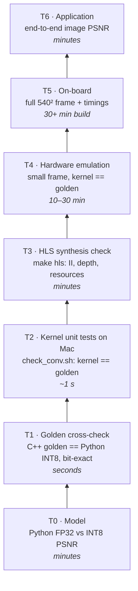
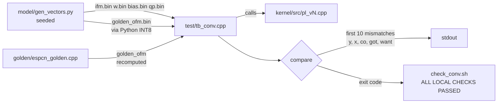

# 02 · Test plan

**Rule:** every test is written, and failing, before the code it tests. A kernel version cannot go to a 30-minute board build until every level below the board passes.

## 1. Test levels



| Level | What it proves | Tool | Pass condition | Required before |
|---|---|---|---|---|
| T0 | The quantized model is good enough to be worth accelerating | `model/eval_psnr.py` | INT8 within 0.3 dB of FP32, above bicubic, on Set5 | Exporting weights |
| T1 | The C++ golden model is a faithful reference | `golden/` + Python dump | 0 mismatches on all layer outputs for 3 images | Any kernel work |
| T2 | Kernel logic and indexing are correct | `test/check_conv.sh` | 0 mismatches on every case in §2 | `make hls` |
| T3 | Pragmas did what we intended | `make hls`, HLS log | Target loops at expected II; no unexpected partition blow-up; HLS finishes in under ~10 min | Board build |
| T4 | Generated RTL + AXI + host flow are correct | `make all TARGET=hw_emu` | `TEST PASSED` on the 16×16 and 32×540 frames | M2 sign-off |
| T5 | Real hardware is correct and gives the real timing | `host.exe pl_hw.xclbin` | `TEST PASSED` on 540×540; metrics captured | Reporting numbers |
| T6 | The accelerated app gives the same image | host + `eval_psnr.py` | Output Y plane identical to the CPU-only pipeline | M3 app analysis |

## 2. T2 test cases (kernel vs golden, on the Mac)

Each case is a set of generated binary vectors, plus a row in `test/vectors/manifest.csv` with the case name, H, W, seed and purpose.

| Case | H×W | Inputs | Bug class it catches |
|---|---|---|---|
| `impulse_center` | 5×5 | IFM = 0 except one pixel, one channel = 1; real weights | Kernel flipped / ky,kx order wrong (correlation vs convolution) |
| `impulse_per_channel` | 3×3 | Impulse in each of the 64 Cin in turn | Cin bit-slice index off (`8c+7, 8c`) |
| `weight_onehot` | 4×4 | Random IFM; one nonzero weight per Cout | Cout ↔ weight-word mapping, output packing order |
| `border_ones` | 4×6 | All ones | Zero padding at corners and edges |
| `saturate_hi` | 4×4 | Max positive IFM and weights | INT32 accumulator, upper clamp at 127 |
| `saturate_lo` | 4×4 | Opposite signs → large negative | ReLU / lower clamp at 0 |
| `rounding` | 4×4 | Values that land on exact .5 after shift | Round-half-up rule matches `quant.h` |
| `odd_rows` | 7×8 | Random | Line-buffer start/end conditions with odd H |
| `min_frame` | 1×2 | Random | Degenerate frame (window never "full") |
| `random_small` | 16×16 | Random, seeds 1–5 | General correctness |
| `random_wide` | 32×540 | Random | Full-width line buffer, frame width = 540 |
| `real_frame` | 540×540 | Real L1 output from a Set5 image | Final full-size check |

For dataflow versions (V3+), the testbench also checks that **every stream is empty after the kernel returns**. Data left in a stream, or a read from an empty one, would hang on hardware (the Lab 3 V4 lesson). The local `hls_stream.h` stub must throw on a read from an empty stream.

## 3. Harness design



- `check_conv.sh <pl_vN.cpp> [case|all]` uses the HLS stub headers in `test/include/` (`ap_int.h`, `hls_stream.h`) and adds an `ap_int<8>`-safe stub if one is needed.
- Mismatch reports name `(y, x, co)` so an index bug points straight at the faulty loop.
- `host.cpp` uses the same comparison function (`golden/compare.h`), so T2, T4 and T5 all report failures the same way.
- Vectors are generated, not committed. `make vectors` (or `python model/gen_vectors.py`) rebuilds them from fixed seeds.

## 4. Per-version gate checklist

Copy this list into the version's `results/vN/NOTES.md`:

```text
[ ] T2 all cases pass on the Mac
[ ] T3 make hls: loop II / depth recorded; matches the prediction in 03-metrics §4
[ ] T4 hw_emu TEST PASSED (V0 and the final version at minimum; required for M2)
[ ] T5 board TEST PASSED on 540×540
[ ] metrics.json filled in (03-metrics §6)
[ ] xclbin + util + timing reports + hls log copied to results/vN/
[ ] pl_vN.cpp saved before pl.cpp is overwritten
```

## 5. What tests deliberately do not cover

- T2 ignores pragmas and timing, and its CPU time is never reported.
- hw_emu times and resources are never reported.
- PSNR (T0/T6) is about model quality. It cannot catch a kernel bug that the bit-exact comparison would miss, so bit-exactness is the correctness gate.

## 6. Visual checks

Every T4/T5 run also produces a difference map (FPGA vs. golden) using `model/visualize.py`. It must be all black. When it is not, its shape points to the bug:

| Diff-map pattern | Likely bug |
|---|---|
| 1-px bright frame at the edges | Zero padding / borders |
| Output shifted by 1 px | Line-buffer window offset |
| Mirrored, blurred or embossed look | ky/kx order (kernel flipped) |
| Fine noise or stripes everywhere | Cin bit-slice `x(8c+7, 8c)` |
| Every other column wrong | 2-px-per-word OFM packing |
| Only some channels wrong | Cout ↔ weight mapping / PE unroll index |
| Top correct, bottom garbage | Loop bound / stream count |
| Scattered ±1 errors | Rounding differs from `quant.h` |
| Errors only in bright regions | Overflow / saturation |

Full details, including the other views, are in [10-visualization.md](10-visualization.md).
