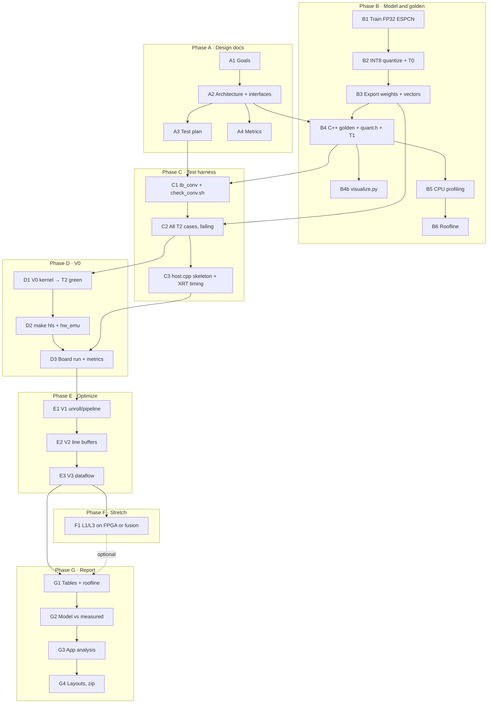

# 04 · Work plan

The work is split into chunks of roughly **one session each (2–4 h)**, except board builds, which mostly mean waiting. Each chunk has a single "Done when" condition. Fill in the milestone dates from the course schedule.

| Milestone | Due | Must contain |
|---|---|---|
| Proposal | TBD | Phase A + Phase B profiling |
| M1 | TBD | Phase B complete, roofline |
| M2 | TBD | Phases C–E, hw_emu passing |
| M3 | TBD | Phases F–G, final report and zip |

## Dependency map



---

## Phase A · Design docs (Proposal)

| # | Chunk | Output | Done when |
|---|---|---|---|
| A1 | Goals, scope, success criteria | `00-goals.md` | Goals have measurable pass conditions |
| A2 | Architecture, kernel interface, data layouts, quantization contract | `01-architecture.md` | Kernel signature and every layout are fixed |
| A3 | Test levels and T2 case list | `02-test-plan.md` | Every T2 case names the bug class it catches |
| A4 | Metric definitions and model | `03-metrics.md` | Every report field has a source and a formula |
| A5 | Proposal PDF | `reports/proposal.pdf` | Covers the guideline's 5 proposal bullets |

## Phase B · Model and golden reference (Proposal → M1)

| # | Chunk | Output | Done when |
|---|---|---|---|
| B1 | Train or obtain an FP32 ESPCN ×2 with ReLU on T91/DIV2K; Y channel | `model/train.py`, `espcn_fp32.pt` | Set5 PSNR is above bicubic |
| B2 | Post-training INT8 quantization; integer-only Python inference using the `quant.h` rules | `model/quantize.py` | **T0** passes |
| B3 | Export weights/bias/qparams in the §3 layouts; generate seeded test vectors + manifest | `model/export.py`, `gen_vectors.py` | Files load; sizes match the layout table |
| B4 | `quant.h` + C++ golden for L1, L2, L3, pixel shuffle; Python cross-check | `golden/` | **T1** passes: 0 mismatches on 3 images |
| B4b | `model/visualize.py`: Views 1 + 3 on CPU-only output; diff map ready for later | `model/visualize.py` | `compare_*.png` for Set5 shows INT8 ≈ FP32 > bicubic ([10-visualization.md](10-visualization.md)) |
| B5 | Per-layer CPU timing (`std::chrono`) on the VCK host and the Mac | `golden/profile_cpu.cpp`, table | Measured layer shares are next to the analytical 7.6 / 87 / 5.4 % |
| B6 | Look up DSP count and DDR bandwidth; plot the roofline | M1 figure | Values cited from the data sheet |

## Phase C · Test harness, built before the kernel (M2)

| # | Chunk | Output | Done when |
|---|---|---|---|
| C1 | `tb_conv.cpp`, `check_conv.sh`, `compare.h`, stub `hls_stream` that throws when empty | `test/` | Runs against an empty stub kernel and reports a clean FAIL |
| C2 | Implement all §2 T2 cases | `test/vectors/manifest.csv` | All cases run; all **fail** on the stub |
| C3 | `host.cpp`: load the .bin files, XRT buffers, warm-up + N timed runs, compare, print the metrics block | `kernel/src/host.cpp` | Compiles on the VM; prints the §2 metric fields |

## Phase D · V0 baseline (M2)

| # | Chunk | Output | Done when |
|---|---|---|---|
| D1 | Plain nested-loop `pl_v0.cpp` that matches the interface | `pl_v0.cpp` | **T2** all green |
| D2 | `make hls`, record loop II/depth, predict cycles; hw_emu on a 16×16 frame | `results/v0/NOTES.md` | **T3** recorded, **T4** passed |
| D3 | Board build + run on 540×540 (may be slow; reduce N_RUNS if needed) | `results/v0/` | **T5** passed; `metrics.json` filled in |

## Phase E · Optimization versions (M2 → M3)

Each version follows the same four steps. Each step is its own chunk.

```text
Ex.a  Update 01-architecture §6 row + predict cycles (03-metrics §4)
Ex.b  Code pl_vN.cpp → T2 green
Ex.c  make hls → II/resources as predicted? (iterate here, not on the board)
Ex.d  Board build → T5 → results/vN/ + metrics.json + model error
```

| # | Version | Key work | Done when |
|---|---|---|---|
| E1 | V1 | On-chip weights, unroll To×Ti (start at 128 MACs, then grow), II=1 on the tap loop, adder tree | II = 1 is confirmed in the log; big speedup over V0 |
| E2 | V2 | Line buffers + 3×3 window; each IFM word read once; packed OFM writes | Measured cycles ≈ H·W·36 at Ti = 16 |
| E3 | V3 | Split into read / window / PE / write dataflow stages with streams | All streams are balanced (T2 empty check); model error ≤ 20 % |
| E4 | M2 sign-off | hw_emu on the final version; M2 report | **T4** passes for the final version |

## Phase F · Stretch (only if E3 is done early)

| # | Chunk | Done when |
|---|---|---|
| F1 | Parameterize the engine (K, Cin, Cout) and run L1 + L3, **or** fuse L1→L2→L3 in one dataflow | T6 output is identical; app speedup beats the 7.7× Amdahl cap |
| F2 | INT8 DSP packing | DSP count per MAC roughly halves; still bit-exact |

## Phase G · Report and submission (M3)

| # | Chunk | Done when |
|---|---|---|
| G1 | `make_table.py` → results table + View 5 charts (perf, roofline, model vs. measured, resources, app breakdown) | No hand-typed numbers |
| G2 | Model vs. measured per version, with explanations for any gaps | Every version has an error % and a reason |
| G3 | App-level analysis: T_app_cpu vs. T_app_fpga, fps, Amdahl, PSNR (T6) | Section written |
| G3b | Demo: `slider.html` + `compare_*.png` for Set5/Set14 from the final version (View 1, 4) | Presentation-ready figures |
| G4 | Vivado layout screenshots, submission zip (`report.pdf`, `src/`, `v0..vN/`) | Zip layout matches the guideline |

## Risk triggers (when to re-plan)

| Signal | Response |
|---|---|
| B1/B2 take more than 2 sessions | Use a pretrained ESPCN and do post-training quantization only; note it in `05-decisions.md` |
| `make hls` takes over 10 min or the tap loop II > 1 | Shrink To×Ti or partition the weights more coarsely. Don't go to the board |
| WNS < 0 | Lower the unroll factor, add pipeline registers, or check for long adder trees |
| Board V0 runs for minutes | Run V0 on a smaller frame and scale the result. Document this in the report |
| E3 not done by M3 − 1 week | Freeze at V2, skip Phase F, and go straight to G |
