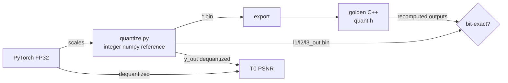

# 06 · Model, quantization and file formats

This doc fixes how the network is trained, how float scales become the integer `requant_mult` / `requant_shift` the kernel uses, and the exact byte format of every file passed between Python, the golden model, the testbench and `host.cpp`. It is the input contract for Phase B ([04-plan.md](04-plan.md)).

Refs: ESPCN [R1], integer-only quantization [R10], gemmlowp fixed-point requantization [R11]. See [07-references.md](07-references.md).

---

## 1. Model

| Item | Choice | Note |
|---|---|---|
| Network | ESPCN ×2: conv5×5(1→64) → ReLU → conv3×3(64→32) → ReLU → conv3×3(32→4) → PixelShuffle(2) | ReLU replaces tanh (D3 in [05-decisions.md](05-decisions.md)) |
| Padding | Zero, "same" (pad 2 for 5×5, pad 1 for 3×3) | Must match `quant.h` |
| Input | Y channel of YCbCr (BT.601), scaled to [0, 1] in FP32 | Chroma uses bicubic ×2 |
| Train data | DIV2K train (800 imgs) [R13] (D11) | Random 32×32 LR patches (D12), LR made with bicubic ↓2 |
| Eval data | Set5 [R15], Set14 [R16]; PSNR/SSIM on Y, crop 2 px border | [03-metrics.md](03-metrics.md) §6 |
| Starting code | An existing PyTorch ESPCN [O1/O2], changed to ReLU and Y-only | Faster than writing from scratch (risk trigger in 04-plan) |
| Optimizer | Adam, lr 1e-3 → 1e-4 at 80 %, L1 loss, batch 64, 100k iterations (D12) | `model/train.py` defaults |

**Gate T0:** FP32 Set5 PSNR is above bicubic. Then INT8 PSNR beats bicubic by at least 1.0 dB and is within 0.5 dB of FP32 (D19; was 0.3 dB).

## 2. Quantization scheme

This is post-training, symmetric, per-tensor INT8 quantization, following the integer-only scheme of [R10], simplified to zero-point = 0 everywhere.

| Tensor | Type | Scale | Zero point |
|---|---|---|---|
| Input Y | int8, range [0, 127] | s_x0 = 1/127 | 0 |
| Weights, layer ℓ | int8, range [−127, 127] | s_wℓ = max(|W|) / 127 | 0 |
| Bias, layer ℓ | int32 | s_wℓ · s_xℓ | 0 |
| Activation after ReLU (L1, L2 outputs) | int8, range [0, 127] | s_yℓ = calibrated max / 127 | 0 |
| L3 output (no ReLU) | int8, range [−128, 127] | s_y3 = calibrated max|y| / 127 | 0 |

- **Cross-layer equalization (CLE) [R28]:** before calibration, rescale L1→L2 and L2→L3 so each channel pair has the same weight range (20 iterations). ReLU passes positive scales through, so the FP32 output is unchanged and the kernel contract stays per-tensor. Without it, one L2 output channel (|w| up to 1.27 vs a median channel max of 0.26) makes per-tensor INT8 lose 0.93 dB on Set5 (D18).
- **Calibration:** run the FP32 model on about 50 training images. Take the 99.99th-percentile activation per layer, not the absolute max, so outliers don't waste range. Each image contributes at most 1M values per layer, sampled with a fixed seed, so calibration fits in laptop RAM (D17). Per-channel weight scales were tested after CLE and gained only 0.08 dB, so they are not used. That would change the kernel interface: bias + mult/shift per Cout. Log it in 05-decisions first.
- Float → int8 weight rounding happens only in `export.py`. Any rounding mode is fine there (`torch.round` rounds half to even). Bit-exactness is unaffected because everything downstream uses the exported integers.

## 3. Requantization: float scale → integer `mult`, `shift`

For layer ℓ, the real rescale factor is:

```text
M = (s_wℓ · s_xℓ) / s_yℓ          (expected 0 < M < 1)
```

Represent it as `M ≈ mult · 2^(−shift)`, with `mult` a positive int32 in [2^30, 2^31):

```python
def quantize_multiplier(M):
    assert 0 < M < 1
    shift = 0
    while M < 0.5:
        M *= 2; shift += 1
    mult = round(M * (1 << 31))      # in [2^30, 2^31]
    if mult == (1 << 31):
        mult //= 2; shift -= 1
    return mult, shift + 31          # total right shift applied to acc * mult
```

The kernel and golden model then compute (see `quant.h`, [01-architecture.md](01-architecture.md) §3):

```text
prod  = (int64) acc * mult
out   = (prod + (1LL << (shift - 1))) >> shift      // round half up (arithmetic shift)
out   = clamp(out, lo, hi)                           // lo=0 for ReLU layers, -128 for L3
```

- `shift` is typically 31–40, so the product needs **64 bits**. In HLS, use `ap_int<64>`. That costs about 2–3 DSPs per output channel × To, which is small next to the MAC array.
- The Python integer reference (`quantize.py`) must implement **exactly** this formula with integer ops (`numpy.int64`). It must not use float `round(acc * M)`.

## 4. File formats

All files are raw little-endian binaries with **no header**. Sizes are fixed by the manifest. Each file has a `.bin` extension and is written by `model/export.py` or `model/gen_vectors.py`.

| File | dtype | Shape / layout | Bytes (540²) |
|---|---|---|---:|
| `y_in.bin` | int8 | H×W (input Y, already quantized) | 291,600 |
| `l1_w.bin` | int8 | [64][5][5][1] | 1,600 |
| `l1_b.bin` | int32 | [64] | 256 |
| `l2_w.bin` | int8 | [32][3][3][64] = kernel word order | 18,432 |
| `l2_b.bin` | int32 | [32] | 128 |
| `l3_w.bin` | int8 | [4][3][3][32] | 1,152 |
| `l3_b.bin` | int32 | [4] | 16 |
| `qparams.bin` | int32 | [l1_mult, l1_shift, l2_mult, l2_shift, l3_mult, l3_shift] | 24 |
| `l1_out.bin` (= L2 IFM) | int8 | H×W×64, HWC | 18,662,400 |
| `l2_out.bin` (= L2 OFM, golden) | int8 | H×W×32, HWC | 9,331,200 |
| `l3_out.bin` | int8 | H×W×4, HWC | 1,166,400 |
| `y_out.bin` | int8 | 2H×2W after pixel shuffle | 1,166,400 |

**Pixel shuffle order** (PyTorch `PixelShuffle(2)` semantics): `out[2y+dy][2x+dx] = l3[y][x][dy*2 + dx]`.

**Manifest** (`vectors/manifest.csv`): `case,H,W,seed,dir,purpose`. Each case directory holds the subset of files that case needs, plus `shape.txt` (`H W`, text) so `host.exe` can be given just the directory. The T2 cases in [02-test-plan.md](02-test-plan.md) §2 use `l1_out.bin` (IFM), `l2_w.bin`, `l2_b.bin`, `qparams.bin` and the golden `l2_out.bin`.

Because the IFM is 64 int8 values per pixel in HWC order and int8 is little-endian, `l1_out.bin` maps byte-for-byte onto the kernel's 512-bit words (channel c sits at bits 8c+7:8c). The host can `memcpy` it straight into the XRT buffer.

## 5. Cross-check chain (gate T1)



The numpy integer reference and the C++ golden model are written independently. Agreement between them is the evidence that `quant.h` is correct. Only after that is the golden model trusted to judge the kernel.

## 6. Open questions (resolve during B2)

- Is per-tensor weight scaling enough for L1? It has only 1 input channel, so the 64 filters can have very different ranges. If T0 fails, try per-channel for L1 only, since L1 runs on the CPU and the kernel contract is not affected.
- Clipped ReLU (ReLU6-style) might give better activation range use. Decide based on the T0 result and record it in 05-decisions.
