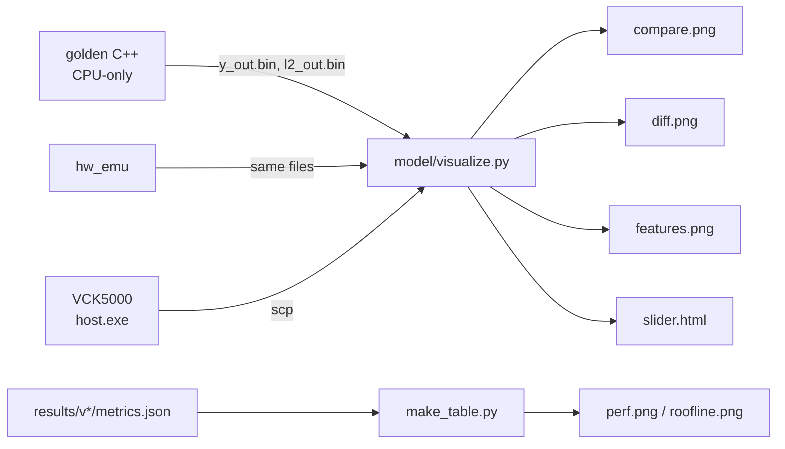

# 10 · Visualization: seeing it work

The FPGA has no display. `host.exe` writes `.bin` files, which get copied to the Mac and turned into images and charts there. One script, `model/visualize.py`, reads output from **any** stage (CPU-only golden model, hw_emu, or board), so the full pipeline can be seen in Phase B, weeks before a kernel exists.



File formats are defined in [06-model-and-quantization.md](06-model-and-quantization.md) §4.

---

## View 1: Side-by-side comparison (does it look right?)

```text
┌────────────┬────────────┬────────────┬────────────┬────────────┐
│ Low-res    │ Bicubic ×2 │ CPU INT8   │ FPGA       │ Original   │
│ (nearest)  │ PSNR dB    │ PSNR dB    │ PSNR dB    │ high-res   │
├────────────┼────────────┼────────────┼────────────┼────────────┤
│  zoomed crop of the same region (edges, text, eyes) in each    │
└────────────────────────────────────────────────────────────────┘
```

- Colour image = upscaled Y (from `y_out.bin`, dequantized) + bicubic ×2 Cb/Cr → RGB.
- The PSNR in each title is computed as in [03-metrics.md](03-metrics.md) §6.
- Output: `compare_<image>.png`. This is also the main demo and report figure.

## View 2: Difference map (is it exactly right?)

`|FPGA − golden|` of `l2_out.bin`, max over the 32 channels, shown as a heatmap of size H×W.

- **Pass looks like:** a completely black image titled `0 mismatches / 9,331,200`.
- **Fail:** non-zero pixels are highlighted. The title shows the mismatch count and the first `(y, x, co, got, want)`, the same format as `tb_conv.cpp`.
- Run it after every T4 and T5 run. Save it as `results/vN/diff.png`.

### Bug fingerprints

The *shape* of the difference map points to the bug:

| What the diff map shows | Likely bug | Where to look |
|---|---|---|
| Bright 1-px frame around the edges only | Zero padding / border handling | Window logic at `y=0`, `x=0`, `y=H−1`, `x=W−1` |
| Whole image wrong, but output looks shifted by 1 px | Line-buffer window offset (output emitted one step early or late) | Window shift / output index |
| Output looks mirrored, blurred or "embossed" | Kernel flipped: ky/kx order (correlation vs. convolution) | Weight index `co*9 + ky*3 + kx` |
| Fine noise or stripes everywhere | Cin bit-slice index wrong | `x(8c+7, 8c)` |
| Every other column wrong | 2-pixels-per-word output packing | OFM pack / word index |
| Specific channels wrong (see View 3) | Cout ↔ weight-word mapping or PE unroll index | Weight partition / To loop |
| Top part correct, garbage or zeros below | Loop bound or stream count mismatch | Row loop limits; dataflow stage trip counts |
| Small ±1 errors scattered | Rounding rule differs from `quant.h` | Requantization shift / rounding constant |
| Large errors only at bright regions | Overflow / saturation | Accumulator width, clamp |

This table is mirrored in [02-test-plan.md](02-test-plan.md) §6.

## View 3: Feature-map mosaic (is each channel right?)

A 4×8 grid of the 32 L2 output channels, as golden | FPGA | diff. It catches channel-specific bugs that View 2's max-over-channels hides. It also makes a good explainer figure ("what the accelerated layer computes").

Output: `features_<image>.png`.

## View 4: Before/after slider (presentation demo)

A single self-contained `slider.html` with images embedded as base64. Drag the slider to compare bicubic and FPGA output (or the original and FPGA). It also shows PSNR, kernel time and fps from `run.log`.

For a live-feeling demo, run `host.exe` on a sequence of Set5/Set14 images and regenerate the page, or step through the `compare_*.png` files.

## View 5: Performance charts (is it getting faster, and why?)

Generated by `model/make_table.py` from `results/v*/metrics.json`. No numbers are typed by hand.

| Chart | Shows |
|---|---|
| `perf.png` | Kernel time (log scale) and GOPS per version, V0 → Vn |
| `roofline.png` | Compute and memory roofs ([03-metrics.md](03-metrics.md) §5), with each version as a labeled point |
| `model_vs_measured.png` | Predicted vs. measured cycles per version, with error % labels |
| `resources.png` | DSP / BRAM / LUT % per version (stacked or grouped bars) |
| `app_breakdown.png` | Stacked bar: L1 / L2 / L3 / transfers / shuffle time, CPU-only vs. CPU+FPGA (Amdahl view) |

---

## Script interface

```bash
# image views (Views 1–4)
python3 model/visualize.py \
    --image  data/Set5/butterfly.png \
    --golden test/vectors/real_frame \
    --fpga   results/v3/out_butterfly \
    --out    results/v3/vis/
# → compare_butterfly.png, diff_butterfly.png, features_butterfly.png, slider.html

# performance charts (View 5)
python3 model/make_table.py results/ --out reports/figs/
```

- `--fpga` is optional. Without it, the script shows CPU-only results, for Phase B.
- The exit code is non-zero if the difference map has any mismatch, so the script can also act as a test step.
- Dependencies: `numpy`, `Pillow`, `matplotlib`, `scikit-image` (for SSIM).

## When each view is used

| Phase ([04-plan.md](04-plan.md)) | Views |
|---|---|
| B: model + golden | 1 (CPU-only vs. bicubic), 3 (sanity check of the features) |
| C/D/E: each kernel version | 2 after every T4/T5 run; 3 when View 2 shows a failure |
| G: report + presentation | 1, 4, 5 |
