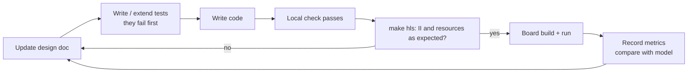

# Project docs

These are the design-first, test-first documents for the ESPCN INT8 conv accelerator on the VCK5000. Each one answers a single question. Write or update the relevant doc **before** writing the code it describes.

| Doc | Question it answers |
|---|---|
| [00-goals.md](00-goals.md) | Why are we building this, what counts as success, and what is out of scope? |
| [01-architecture.md](01-architecture.md) | What does the system look like, from the full app down to the kernel's loops and data layouts? |
| [02-test-plan.md](02-test-plan.md) | How do we know each piece is correct, and which test must pass before moving on? |
| [03-metrics.md](03-metrics.md) | How exactly is every reported number measured and calculated? |
| [04-plan.md](04-plan.md) | What are the work chunks, in what order, and when is each one done? |
| [05-decisions.md](05-decisions.md) | Which design decisions have been made, and why? |
| [06-model-and-quantization.md](06-model-and-quantization.md) | How is the model trained and quantized, how are `mult`/`shift` derived, and what is the byte format of every file? |
| [07-references.md](07-references.md) | Which papers, repos and data sheets back each claim, with IDs to cite? |
| [08-runbook.md](08-runbook.md) | What are the exact commands for this project (Makefile changes, upload, build, run, save)? |
| [09-report-outline.md](09-report-outline.md) | What does each milestone report need, and where does each item come from? |
| [10-visualization.md](10-visualization.md) | How do we *see* it working? (comparison images, diff maps, bug fingerprints, demo slider, performance charts) |
| [../results/TEMPLATE_NOTES.md](../results/TEMPLATE_NOTES.md) | Per-version notes template: prediction, gates, HLS log, measured results, model error |

The project brief, with the workload numbers, roofline and the risks found in the earlier draft, is [fpga_ai_super_resolution_coprocessor_architecture.md](fpga_ai_super_resolution_coprocessor_architecture.md).

## The working rule

A chunk in [04-plan.md](04-plan.md) is only done when its "Done when" line is true. "It compiled" is not enough.
